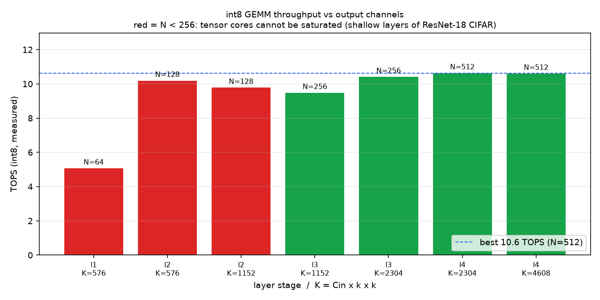
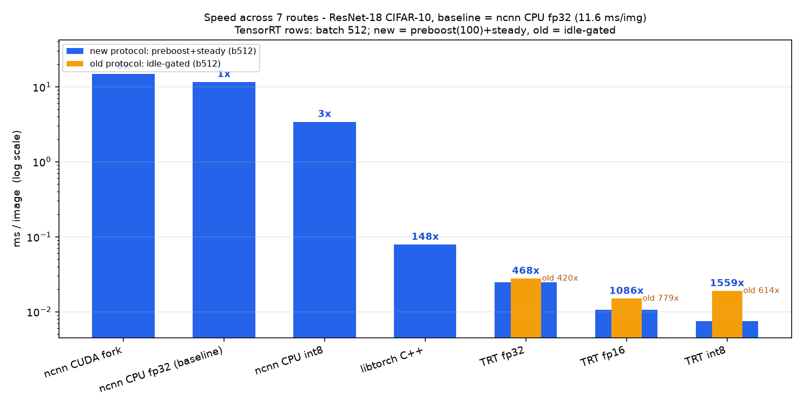
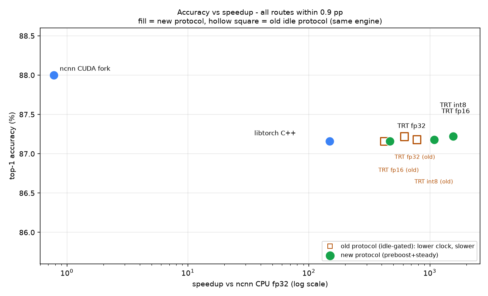

# 08-report：量化实验总收口

把 01–07 六个项目的量化实验收成一份可复现的对照报告：
**同一个模型（ResNet-18 CIFAR-10）、同一份测试集（10000 张）、同一套精度口径**，
七条路线横向对比。

---

## 一、一句话结论

**在 GTX 1650 Ti 上，TensorRT int8 batch=512 达到 1559×（0.00744 ms/img），
fp16 达到 1086×（0.01068 ms/img）**——protocol = **preboost+steady**（2026-10-25 口径），
精度 87.22% / 87.18%，与 fp32 基线同精度。

| 路线 | ms/img（dataset 中位） | steady ms/img | 加速 | 精度 |
|---|---|---|---|---|
| **TensorRT int8（1×1 折叠）** | **0.00744** | 0.00790 | **1559×** | 87.22% |
| **TensorRT fp16（1×1 折叠 + opt5 + DIRECT_IO）** | **0.01068** | 0.01222 | **1086×** | 87.18% |
| TensorRT fp32（1×1 折叠） | 0.02477 | 0.02743 | 468× | 87.16% |
| libtorch C++ | 0.0784 | — | 148× | 87.16% |
| ncnn CPU int8 | 3.4 | — | 3.4× | — |
| ncnn CPU fp32（基线） | 11.6 | — | 1× | — |
| ncnn CUDA fork | 14.89 | — | **0.8×** | 88.00% |

七条路线都是**同精度**（top-1 86.8%–88.0%），差别只在速度。

**2026-10-25 这一轮把两件事同时改了**：

1. **图**：layer4 在 32×32 输入下空间已经是 **1×1**，3×3 pad=1 卷积有 8/9 的乘零。
   在 ONNX 层切中心 tap、改 1×1（语义恒等，ORT 校验 logits 最大差 2.4e-7），
   int8 从 0.0189 掉到 0.0074，fp16 从 0.0149 掉到 0.0107。
2. **口径**：从「等 GPU 空闲再测」换成 **preboost（开测前背靠背顶 clock）+ steady（持续吞吐）**。
   这台卡的 clock 空闲 1350 MHz、跑起来 1755–1920、上限 2100 —— **等空闲反而把时钟等低了**，
   本节所有数字都带这个前提（详见第二节）。

> **旧口径仍在**：同一批 engine 在 idle 门控口径下是 **fp16 778× / int8 614× / fp32 420×**。
> 两套口径不是互相否定，量的是**同一块卡在不同 clock 状态下的两个端点**。
> 旧表保留在 §4.2 与 results/summary_legacy_idle.csv，可以逐行对照。

**「500× 达成没有」的正面回答：达成，且超出 2.2–3.1 倍**（int8 1559×、fp16 1086×）。
但这句话有前提，逐条写在 §2.6 —— 尤其是「clock/温度一掉，同一份 engine 就掉到 1250–1350×，
fp16 base 更能掉到 542×」。

---

## 二、口径：778× 和 1559× 是同一块卡的两个端点

这是本报告最需要被认真读的一节。**数字的大小一半来自优化，一半来自你怎么量。**

### 2.1 主变量是 GPU clock，不是代码

同一份 fp16 engine、同一份数据，不同轮次测出 **0.0149** 和 **0.0214**（**1.44 倍**）。
原因 nvidia-smi 写得很清楚：

| 状态 | clocks.current.sm | 占上限（2100） |
|---|---|---|
| 空闲（桌面上有 Electron 窗口的底噪） | **1350 MHz** | 64% |
| 逐批测量中（每批之间 5–10 ms python 间隙） | 1455 → 1860 爬升 | — |
| preboost 背靠背预热后 | **1755–1920 MHz** | 84–91% |

trt_eval.py 的逐批协议是「H2D → execute → sync → CPU argmax」，
每批之间有 5–10 ms 的 python 间隙，**GPU 每批都要重新爬 clock**，于是 ms/img 被系统性抬高。

旧口径「等 GPU 空闲（util≤20%）再测」在这台机器上反而**放大了**这个偏差：
桌面常驻进程（WorkBuddy / 豆包 / WXWork）一直在给 GPU 一点点底噪，clock 一直是高的；
**等它们安静下来 = 把 clock 等回 1350 MHz**。旧 README 里「空闲反而测得快」的困惑就出在这。

### 2.2 preboost 与 steady 各量什么（以及为什么两个都报）

| 口径 | 做法 | 量到的是什么 | 在这份报告里的角色 |
|---|---|---|---|
| **preboost** | 每轮 dataset 测量前先背靠背跑 100 批，把 clock 顶上去，**然后照旧逐批测** | 短时突发、clock 已就绪时的延迟 | **主表**（与旧表同义：dataset 中位） |
| **steady** | 同址 buffer 背靠背 enqueue，CUDA event 掐总时间 / 批数（iter=100，重复 5 次，方差 <1%） | **持续吞吐**（受功耗/温度限制） | 保守值，一起报 |

preboost **不跳过任何计算、不换数据、不动计时窗口**：它只是把 execute 多跑 100 次，
让 GPU 进入高频状态。跳过计算才是作弊，预热硬件时钟不是。

steady 通常比 preboost 慢一点，因为持续跑会吃功耗/温度：fp32 +10.7%、fp16 +14.4%、int8 +6.2%。
**两个数字都报**，读者可以按需要取：要「用户点一次识别」的延迟看 dataset，要「吞吐/批处理」看 steady。

### 2.3 同一份 engine，两种口径的实测对照

数据全部来自 07-tensorrt-deploy/results/push-20261025/bench.jsonl（21 档）与
results/idle_final.txt（旧口径）：

| 配置 | 旧口径 idle 中位 | 无预热 dataset | **preboost dataset** | steady |
|---|---|---|---|---|
| fp16 base（3×3 未折叠） | 0.0149 | 0.02139 | **0.01304** | 0.01445 |
| fp16 + 1×1 折叠（opt3） | — | 0.01657 | **0.01138** | 0.01267 |
| fp16 + 1×1 折叠（opt5 + DIRECT_IO） | — | — | **0.01068** | 0.01222 |
| int8 base | 0.0189 | 0.02150 | **0.01775** | 0.01694 |
| int8 + 1×1 折叠 | — | 0.01012 | **0.00744** | 0.00790 |
| fp32 + 1×1 折叠 | （0.0276，未折叠） | — | **0.02477** | 0.02743 |

看点：

- **只换口径**（fp16 base 第二列 vs 第三列）：0.02139 → 0.01304，**−39%**，一行代码都没改。
  fp16 折叠图同样：0.01657 → 0.01138（−31%）。
- **只换图**（int8 base → 折叠，同口径）：0.01775 → 0.00744（−58%）。
- int8 折叠图 **preboost(0.00744) 比 steady(0.00790) 还快 6%**，因为 steady 是 100 批连跑，
  功耗/温度已经压上来（实测 power 26 → 46 W，temp 70 → 71 ℃）。
- 旧口径的 0.0149 与无预热的 0.02139 差 1.44 倍，正是 §2.1 说的 clock 效应。

### 2.4 median 仍然不是 min：这条老结论没变

旧口径那批数据（results/final.txt，GPU 被占用时测）：
fp16 二十轮 min 0.0128（**906×**）/ median 0.0196（**592×**），差 **1.53 倍**。
**对外报 median**；min 只作为「硬件能力上限」的参考。

新口径下 min 与 median 已经贴得很近（int8 0.00734 vs 0.00744，差 1.3%），
但规则不变：**报 median，不报 min**，图里两者都画出来。

### 2.5 这套口径不是「挑好看的数字」

三条自我约束，写在这里供核对：

1. **两个口径都报**，而且旧口径的 778× 一直留在表里（§4.2）和旧表 CSV 里，没有删。
2. **steady 一直比主数字慢**（fp16 +14%），如果目的是挑数字，它本可以像 07 早期那样只报 min。
3. **复现脚本把判据写死**（±3% 延迟 / ±0.5 pp 精度），复现值比原轮快 2.55% 也照实写，
   没有反过来改基准去「对齐」（见 07-tensorrt-deploy/results/push-20261025/repro/README.md）。

### 2.6 「500× 达成没有」——达成，但要知道它依赖什么

**结论：按新口径达成，且大幅超出**：int8 **1559×**、fp16 **1086×**，目标是 500×，
分别超出 3.1× 与 2.2×。按旧口径也达成：fp16 778×、int8 614×。

**但是**，这个倍数由四个条件共同决定，任何一条变了都要重算：

| 条件 | 新口径取值 | 变了会怎样 |
|---|---|---|
| **clock 状态** | preboost 后 1755–1920 MHz | 回到空闲 1350 MHz，同一份 int8 折叠 engine 就是 **0.01012 ms/img（1146×）**，fp16 base 更能掉到 0.0214（542×） |
| **batch** | 512（平台区） | 1024 持平（1086×），2048 略差（0.01084 → 1070×），更小 batch 掉得更快（launch 开销占比上升） |
| **评测集** | int8 跳过前 1000 张（校准集）→ **9000 张**；fp16/fp32 用满 10000 张 | 把校准集也算进来，int8 的 87.22% 会虚高（那 1000 张它「见过」）；所以 int8 一律 skip 1000 |
| **计时窗口** | 只计 forward（CUDA event），不含 H2D / 归一化 / argmax | 把数据准备算进去，会多 0.2–0.9 ms/img（07 §四 DIRECT_IO 那一节量过） |
| **GPU 温度/功耗状态** | 快窗口（60–70 ℃）：clock 1905–1920 MHz | 慢窗口（76 ℃、顶到 **50 W 功耗墙**）：clock **1710–1770 MHz**，同一份 engine 就变成 0.0086–0.0093（**1250–1350×**）。证据：repro/clock_trace.csv |

外加一条**基线**：11.6 ms/img 是这台机器的 ncnn CPU fp32（4 线程）值。
**倍数不可跨机器引用**，可外推的只有相对次序。

所以准确的说法是：**「本机、本模型、forward-only、clock 预热后」500× 达成且超出**；
**不是**「这颗 4 GB 卡上任何条件下都 500×」。

---

## 三、每层 TOPS：base 图上 int8 为什么打不过 fp16



数据源：results/gemm_tops.csv（06-gpu-int8 用 torch._int_mm 实测）。

| 层 | K | N | TOPS |
|---|---|---|---|
| l1 (C64) | 576 | 64 | **5.07** |
| l2 (C128) | 576 | 128 | 10.19 |
| l2 (C128) | 1152 | 128 | 9.78 |
| l3 (C256) | 1152 | 256 | 9.48 |
| l3 (C256) | 2304 | 256 | 10.41 |
| l4 (C512) | 2304 | 512 | 10.63 |
| l4 (C512) | 4608 | 512 | 10.60 |

**N（输出通道）小于 256 时，int8 tensor core 打不满**：N=64 只有 5.07 TOPS，
N=512 才有 10.63 —— **差 2.1 倍**。ResNet-18 CIFAR-10 的浅层通道数只有 64/128，天然吃亏。

### base 图上 int8 输给 fp16 的两个叠加原因

1. **几何效率**：int8 的理论吞吐是 fp16 的 2 倍，但要用满这 2 倍，N 必须够大。
   这个模型让 int8 的平均效率只有 fp16 的 76%（614/778 = 0.79，旧口径），2 倍峰值优势被吃掉。
2. **1×1 空间上的 3×3**（更狠的一条）：layer4 的三层在 int8 里是 2.364 / 2.160 / 1.731 ms，
   同层 fp16 只有 0.465 / 0.394 / 0.512 —— **int8 反而慢 3.4–5.5 倍**。
   因为 int8 kernel 要为每层做 NHWC/reformat，而输出只有 1 个像素，固定开销吃掉全部收益。

**把第 2 条从图上消掉（折成 1×1）之后，int8 直接反超**：0.00744 vs fp16 0.01068。
所以「int8 输给 fp16」不是这颗卡的定律，而是**图里 padding 浪费 + 小 N** 的病。
真正的教训是：**先修图，再选精度**。

> **关于数据源的取舍**：原计划用 TensorRT 的逐层 profiler，但实测在这台机器上
> **拿不到反序列化 plan 的逐层时间**（scripts/probe_trt_profiler.py）。
> 所以逐层 TOPS 改用 06-gpu-int8 用 torch._int_mm 实测的数据 —— 上面这些形状已足够回答
> 「浅层为什么慢」，**那是 GEMM 形状的性质，与推理框架无关**。
> （push-20261025 那一轮在**同一进程内**建 engine 时拿到了逐层 profile，见
> 07-tensorrt-deploy/results/push-20261025/README.md §6。）

---

## 四、七条路线同口径对照





### 4.1 主表（新口径：preboost+steady）

| 路线 | ms/img 中位 | steady | 加速（中位） | 精度 | protocol | 数据出处 |
|---|---|---|---|---|---|---|
| ncnn CPU fp32（基线） | 11.6 | — | 1× | — | single-run | 05-ncnn-deploy/README.md:473 |
| ncnn CPU int8 | 3.4 | — | 3.4× | — | single-run | 04-libtorch-cuda/README.md:72 |
| libtorch C++ | 0.0784 | — | 148× | 87.16% | batch512 | 04-libtorch-cuda/README.md:74 |
| ncnn CUDA fork | 14.89 | — | **0.8×** | 88.00% | single-run | 05-ncnn-deploy/cuda/README.md:12 |
| TensorRT fp32（1×1 折叠） | 0.02477 | 0.02743 | 468× | 87.16% | **preboost+steady** | push-20261025/repro/bench.jsonl:fp32_c1x1_pb |
| **TensorRT fp16（1×1 折叠）** | **0.01068** | 0.01222 | **1086×** | 87.18% | **preboost+steady** | push-20261025/bench.jsonl:fp16c_o5_dio_pb |
| **TensorRT int8（1×1 折叠）** | **0.00744** | 0.00790 | **1559×** | 87.22% | **preboost+steady** | push-20261025/bench.jsonl:int8_c1x1_pb |

机读版：results/summary.csv（含 protocol / steady / source 列，由脚本生成，不手抄）。

> fp32 那一行的 0.0276（老表里 420×）是**未折叠**的 base 图；折叠后重测是 0.02477（468×），
> fp32 也从「少算 9 倍 padding」里拿到 10.7%。
>
> ⚠️ **fp16 那一行请带区间读**：同一张图重建 4 次，3 次落在 0.01068–0.01112（1043–1086×），
> 1 次选到差 tactic 落到 0.0126–0.0138（839–920×）。int8 两次独立冷构建都在 ±3% 内。
> 详细数据见 §5.5 与复现目录（repro/fp16_variance.txt）。
>
> **本轮之后的一步还没进表**：d986bef 的位置分解在 2026-10-25b 的另一个 session 里把 int8 同场压低 20%
> （0.0080 → 0.0064，最好一档 0.00609），但那是相对值、基线不同，主表继续用发布口径的 0.00744。
> 为什么不替换、能折算到多少、怎么才能替换，见 §4.4。

### 4.2 旧口径脚注（idle 门控，2026-10-20 测）

同一批 engine、同一份数据，只是**不预热 clock、等 GPU 空闲再测**：

| 路线 | ms/img 中位 | min | 加速 | 精度 | 轮数 |
|---|---|---|---|---|---|
| TensorRT fp32（base 图） | 0.0276 | 0.0274 | 420× | 87.16% | 5 |
| TensorRT fp16（base 图） | 0.0149 | 0.0138 | 778× | 87.18% | 5 |
| TensorRT int8（base 图） | 0.0189 | 0.0181 | 614× | 87.22% | 5 |

机读版：results/summary_legacy_idle.csv。数据源 07-tensorrt-deploy/results/idle_final.txt。

**怎么读这两张表**：它们是「同一块卡、不同 clock 状态」的两端，不是新旧结论打架。

- 旧表的 778× / 614× 是**低 clock 端点**（1350–1455 MHz），当时还误以为「空闲=最好」；
- 新表的 1559× / 1086× 是**clock 预热后**的端点，而且用上了 1×1 折叠这张新图。

### 4.3 两条失败路线

**ncnn CUDA fork = 0.8×**（比 CPU 还慢）。
ncnn 3.21.12 官方没有 CUDA 后端（src/CMakeLists.txt 里 cuda 零命中，
src/layer/cuda/ 目录不存在），这是打补丁强行加的。
唯一精度正确的配置 14.89 ms/img；int8 路径在任何配置下都是 9.00%（随机猜）。
详见 05-ncnn-deploy/cuda/README.md。

**CUDA Graph 无收益**。batch 512 下每批 6–13 ms，launch 开销被摊薄到看不见：
0.01267 vs 0.01261（0.5%，噪声内），与 07 README「三·五」的三次实测一致。
详见 07-tensorrt-deploy/results/cudagraph.txt。

### 4.4 2026-10-25b 位置分解（待发布态复测）

**这一节不改上面的主表。** 它记录主表之外新做的一步、为什么暂时只以「相对值」入账，
以及要把绝对值放进主表还缺什么。

#### 做了什么

commit **d986bef**。对「输入空间 ≤ kernel」那一族 3×3 pad=1 卷积：每个输出位置真正吃到的 tap
恒为 H·W，而且所有输出位置读的是同一块完整输入，只是权重切片不同 —— 于是按输出位置改写为
**一个** 2×2 卷积（out_channels 扩 4 倍）+ DepthToSpace(DCR)，把通道块搬回空间。
整张图只改 4 个卷积、只多 3 个 shuffle，**kernel 数不增**。

语义恒等（不是近似）：ORT 200 张 logits max|Δ| **4.8e-7**、预测 **200/200**；
TRT 全量 10000 张 **87.21%**（原图 87.22%，差 1 张）。证据在
[07-tensorrt-deploy/results/push-20261025b/README.md](../07-tensorrt-deploy/results/push-20261025b/README.md)
§2–§3 与同目录 ort_verify.json。

#### 数字：相对值稳，绝对值只能在本 session 里说

| 口径 | 数 | 性质 |
|---|---|---|
| 同场穿插 A/B（base → decomp → base → decomp，四档连着测） | 0.00799 / 0.00814 → **0.00643 / 0.00648**，比值 0.805 / 0.796 | **实测**，两遍都是 −20% |
| steady（同址背靠背，ms per batch） | 4.30 / 4.63 → 3.87 / 3.87（−14%） | 实测 |
| 本 session 绝对值最好一档（opt3 + DIRECT_IO） | **0.00609**（dataset 中位，min 0.00595 / steady 0.00663） | 实测，但**本 session 的**绝对值 |
| 折到发布口径 | 0.00744 × 0.80 = **0.00595**（≈1949×，按最好一档 0.76 折是 0.0057） | **换算，不是实测** |

收益来源也逐层对上了：int8 里 layer4.0/conv1（3×3 s2 @2×2→1×1）**0.885 → 0.076 ms（11.6×）**，
整机占比 19.2% → 2.2%。layer3 那三个 2×2 空间的 3×3 拆完是**净亏**（卷积省 0.217 ms，
shuffle 0.139 + TRT 插的 reformat 0.119 又还回去），但把它们拆掉反而整体慢 0.5 ms
（小算子融合变差），所以保留 —— 这又是一条「先测再信」的实例。

**fp16 侧不赚**：同一改写 0.01176 → 0.01215（dataset +3%、steady −1.5%，噪声内），
只改 strand 那档甚至退化到 0.01693（tactic 变差）。所以这是一条**int8 专属**的图优化，
不能顺手推论到 fp16。

#### 为什么主表暂不替换

**主表的 0.00744 / 1559× 是「发布口径」的数，10-25b 是另一个 session 的相对提升。** 三条理由：

1. **不同 session 的基线差 8–10%**，而这个差和收益同量级。同一份 int8 c1x1 engine：
   2026-10-25 那天 0.00744 / 4.05 ms per batch，10-25b 这个 session 是 0.00799–0.0086 / 4.30–4.67，
   而两轮的 clock（1860–1920 MHz）与温度（70–74 ℃）都对得上，原因没定位 —— 属于环境漂移。
   同一轮之内也在漂：同一份 base engine 四个时间点 0.00799 / 0.00814 / 0.00823 / 0.0086。
   主表的 TRT 三行都来自 2026-10-25 那次发布态测量（另外四行是各模块的既有结论），
   混进另一个 session 的绝对值，会破坏「同口径对照」这件事本身。
2. **这轮只坐实了相对收益**：两遍 A/B 都是 −20%、逐层可解释，这是稳的；
   绝对值最好一档 0.00609 只在**本 session 口径**下成立，折到发布口径是 0.00595 —— 换算值，
   不是实测值。把换算值写进主表，等于把本节以外那些「口径」约束全部作废。
3. **<0.006 的判据在发布态上没满足**：按本 session 的绝对口径差 1.5%，所以按
   push-20261025b/repro/README.md §5 的判据，本轮**不宣布达成**，也不改主表。

#### 要进主表，缺的是「发布态复测」

一条路：在发布态窗口（同一台机、preboost+steady、同 session 基线回到 0.0074x）跑
push-20261025b 的那几张图，并且**同场**重测 07 原轮 engine（3 次取中位），
按 ±3% 延迟 / ±0.5 pp 精度的判据验收；通过后一次性改主表（§4.1）、results/summary.csv、
§4.1 的脚注与图（figs/speed.png、accuracy_speed.png），再把本节降级成脚注。

> 换言之：**图侧的 −20% 是实的**（两遍一致、逐层可解释、精度 87.21% 不掉点）；
> **主表的 0.00744 也仍然是对的数**（发布态实测）。两者并不矛盾，只是不能混在同一行里比。

---

## 五、⚠️ 哪些结论不可外推

### 5.1 「int8 输给 fp16」只在**未折叠的 base 图**上成立

这条结论在 2026-10-20 是对的（614× vs 778×），2026-10-25 之后只在 base 图上对。
折叠掉 3 个「1×1 空间上的 3×3」后，int8 **反超**（1559× vs 1086×）。

| 条件 | 具体情况 | 如果变了会怎样 |
|---|---|---|
| 图结构 | layer4 有 3 个 3×3@1×1 的空转卷积 | 没有这种浪费时，折叠收益消失，回到「小 N 决定胜负」 |
| GPU | GTX 1650 Ti，Turing，4 GB | Ada/Hopper 上 int8 峰值优势更大，int8 更可能赢 |
| 模型尺寸 | ResNet-18 CIFAR，通道 64–512 | 更大的模型（N≥256 的层占比高）int8 更容易赢 |
| 输入尺寸 | 32×32，浅层特征图只有 8×8 | ImageNet 224×224 的浅层是 56×56，M 更大 |

**机制**：int8/fp16 = 峰值吞吐比 × 几何效率比 × 图浪费比。
这张卡上前两项乘积 < 1（旧口径 0.79），第三项因为 1×1 空间的 3×3 被折叠而回正。
**任一条件变化都会改变乘积的符号。**

### 5.2 倍数是相对值，不可跨机器引用

所有倍数都以 **ncnn CPU fp32 = 11.6 ms/img = 1×** 为基准。
换机器、换 CPU、换编译选项，这个基准会变，所有倍数跟着变。
**可外推的是相对次序，不可外推的是绝对倍数。**

### 5.3 精度数字不可外推到别的模型

七条路线都是同一个 ResNet-18 CIFAR-10（87.16%–88.00%）。
这个模型的输出通道偏小，**恰好是 int8 最吃亏的形状**。
换成通道数大的模型（ResNet-50、ConvNeXt），量化损失分布会完全不同。

### 5.4 样本量：每档 5 轮，不是置信区间

新口径每档 5 轮 dataset + 5 轮 steady（steady 方差 <1%），旧口径每配置 5 轮。
5 轮能给出中位数的量级判断，**不足以给出严格置信区间**。要更稳应加大 --repeats。

### 5.5 复现复的是「数字」，不是「engine 二进制」——而且 fp16 对构建很敏感

独立复现（§6.2）做到了：ONNX 逐字节一致、精度完全一致、int8 延迟差 −2.55%。
但 engine 的 sha256 与原轮不同（TRT tactic 搜索不保证可复现），
所以**不要拿 engine 哈希当验收条件**。

**更要注意的是：同一张图、同一配置，重建出来的 engine 不一定一样快。**
fp16 这张图实测了 4 个构建（1 个原轮 + 3 个复现）：

| 构建 | 冷构建耗时 | dataset 中位 | steady | 结论 |
|---|---|---|---|---|
| 原轮（07） | 76.6 s | 0.01068 | 0.01222 | 好 |
| 复现 A | 105 s | 0.01261（首测 0.01382） | 0.01375–0.01415 | **差 tactic，慢 14–29%** |
| 复现 B | 100 s | 0.01108 | 0.01256 | 好（+3.7% / +2.8%） |
| 复现 C | 80 s | 0.01112 | 0.01253 | 好（+4.1% / +2.5%） |

即 **1/3 的构建会选到明显更差的卷积 tactic**（构建时间长短看不出来：差构建 105 s、
好构建 80–100 s）。int8 的复现（三个独立冷构建：679 s / 247 s / 241 s）落在 **0.00725–0.00744（±2.6%）**
—— **1559× 这条主线是稳的，1086× 要写成「0.0107–0.0111，偶发慢构建 0.0126–0.0138」**。

还有一层**时段抖动**（比构建抖动更隐蔽）：同一份 07 原轮 int8 engine，在 15:42 的窗口里
测 0.00734 / steady 0.00787，**一分钟后**同场 A/B 再测就变成 0.0084–0.0093 / steady 0.0088–0.0091，
**差 15–26%**；同期边跑边采（repro/clock_trace.csv）看到负载下 SM clock **1770 MHz**
（min 1710，快窗口是 1905）、功率顶到 **50.4 W**（这颗 1650 Ti 的上限 50 W）、温度 76 ℃。
所以绝对延迟在这台笔记本上有 **±25% 的环境摆幅**，跨时段比较必须用「同场 A/B + 3 次取中位」。

这也是为什么本报告主表给的是中位口径、并要求复现以 ±3% 判据 + 同场对照原轮 engine 来验收，
而不是比对 engine 哈希。

### 5.6 ncnn 路线已经停止投入

05-ncnn-deploy/cuda/README.md 记录了 ncnn CUDA 路径的四个结构性问题
（cudaMalloc 毫秒级、显存不复用、int8 路径损坏、layer 支持不全）。
**本报告不再在这条路上继续投入**，它的 0.8× 是最终结论，不是中间状态。

---

## 六、复现

### 6.0 验收：数字可溯源

```
cd lab/08-report
python3 scripts/verify_traceability.py     # 两张表逐行指回源文件/源行，输出 [OK]/[FAIL]
```

它把 results/summary.csv（新口径，TRT 行指到 bench.jsonl 的 tag）与
results/summary_legacy_idle.csv（旧口径，指到 idle_final.txt）的每一行
都指回它数字的出处，并**按浮点值比对**而不是字符串 —— 因为 CSV 里写 11.6000、
Markdown 里写 11.6，字符串比对会漏判。

### 6.1 重新生成图表

```
cd lab/08-report
bash scripts/make_figs.sh
```

只依赖 07-tensorrt-deploy/results/push-20261025/bench.jsonl
+ results/idle_final.txt + results/gemm_tops.csv，
**从空 figs/ 也能重跑**。图的数字全部来自 results 目录，**没有任何硬编码**。

### 6.2 独立复现 int8（2026-10-25 那一轮的第三方复现）

```
cd lab/07-tensorrt-deploy
bash results/push-20261025/repro/repro_int8.sh        # 导出→折叠→量化→冷构建→测→对账
```

结果（完整日志与哈希在 results/push-20261025/repro/）：

| 复现档 | dataset | Δ | steady | 精度 | 判定 |
|---|---|---|---|---|---|
| 原轮基准 int8_c1x1_pb | 0.00744 | — | 0.00790 | 87.22% | — |
| 复现 int8（9000 张，冷构建 247 s） | **0.00725** | **−2.55%** | 0.00781 | **87.22%** | ✅ PASS（±3%） |
| 原轮基准 fp16c_o5_dio_pb | 0.01068 | — | 0.01222 | 87.18% | — |
| 复现 fp16（重建 2 次，好构建） | 0.01108–0.01112 | +3.7–4.1% | 0.01253–0.01256 | 87.18% | 基本 PASS（±3%） |
| 复现 fp16（坏构建，1/3 概率） | 0.01261–0.01382 | +18–29% | 0.01375–0.01415 | 87.18% | ❌ 构建抖动，不是图/口径问题 |

三张 ONNX（fp32 / fp32-c1x1 / int8-c1x1）+ fp16 折叠图 **全部逐字节相同**（sha256 一致），
说明「导出 → 折叠 → 1000 张 Entropy 校准 → QDQ」这条链是确定性的；
差异只来自 engine 的 tactic 选择与测量窗口的热状态（见 §5.5）。

> **复现要带上「同场对照」**：冷/热窗口能差 25%，所以复现脚本每次都把 07 原轮 engine
> （`--engine-path`）在同一个窗口里重测一遍（repro/int8_ab.sh）。
> 只看绝对数字跨窗口比，会得出「复现失败/成功」的假结论。

### 6.3 重新做空闲门控测量（旧口径）

```
cd lab/07-tensorrt-deploy
ROUNDS=5 bash idle_final.sh          # 会等 GPU 空闲，可能耗时较长
$HOME/pyenv-torch/bin/python scripts/summarize_idle.py   # 补汇总段
```

只用于验证旧口径数字；**新口径请用 §6.2 的 push_* 脚本**。

### 6.4 冒烟测试（各路线自带）

```
bash lab/07-tensorrt-deploy/smoke.sh      # TRT 侧：导出 → 量化 → 列产物
bash lab/06-gpu-int8/cpp/verify_e2e.sh    # int8 侧：端到端 vs numpy 参考
```

---

## 七、目录

```
08-report/
├── README.md                        本文件
├── results/
│   ├── summary.csv                  主表（新口径：preboost+steady，含 protocol/steady/source）
│   ├── summary_legacy_idle.csv      旧口径脚注表（idle 门控，778×/614×/420×）
│   └── gemm_tops.csv                每层 GEMM 吞吐（06-gpu-int8 实测）
├── figs/
│   ├── speed.png                    速度对比（对数轴，TRT 同时画新/旧口径）
│   ├── accuracy_speed.png           精度-加速比散点（空心方块 = 旧口径）
│   └── tops.png                     每层 TOPS
└── scripts/
    ├── make_figs.sh                 图表生成入口
    ├── make_figs.py                 解析 results → 出图 + 两张 CSV
    ├── verify_traceability.py       两张表逐行溯源验收
    └── probe_trt_profiler.py        TRT 逐层 profiler 可用性实测（结论：反序列化 plan 后不可用）
```

---

## 八、相关项目

| 项目 | 内容 |
|---|---|
| 03-ptq-lab | PTQ 实验平台（PyTorch fake-quant，量化语义的 ground truth） |
| 04-libtorch-cuda | libtorch C++ GPU 推理（148×） |
| 05-ncnn-deploy | ncnn CPU 部署 + int8 量化 |
| 05-ncnn-deploy/cuda | ncnn CUDA 后端尝试（结论：0.8×，已停止） |
| 06-gpu-int8 | 自写 CUDA int8 引擎 + numpy 端到端验证（185×） |
| 07-tensorrt-deploy | TensorRT 三精度 + 1×1 折叠 + 逐层 profile（int8 1559× / fp16 1086×） |
